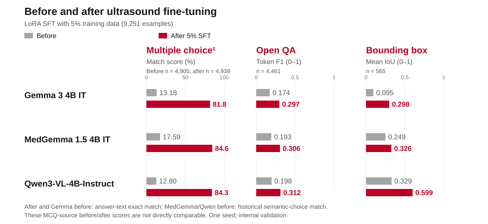
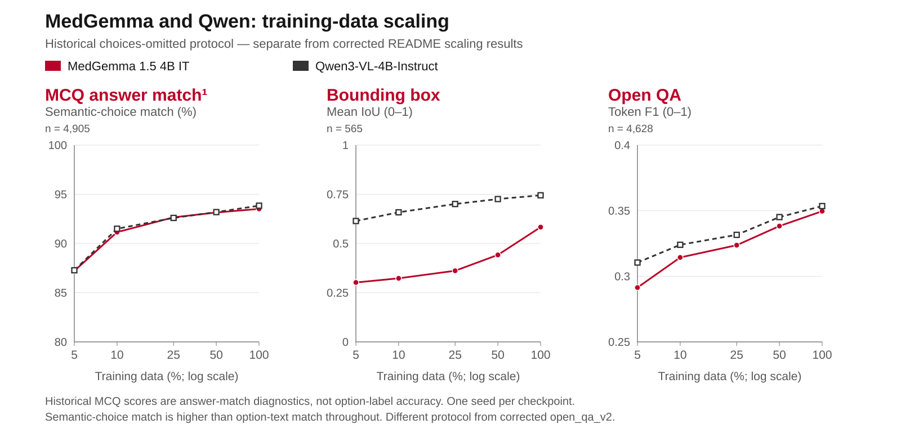
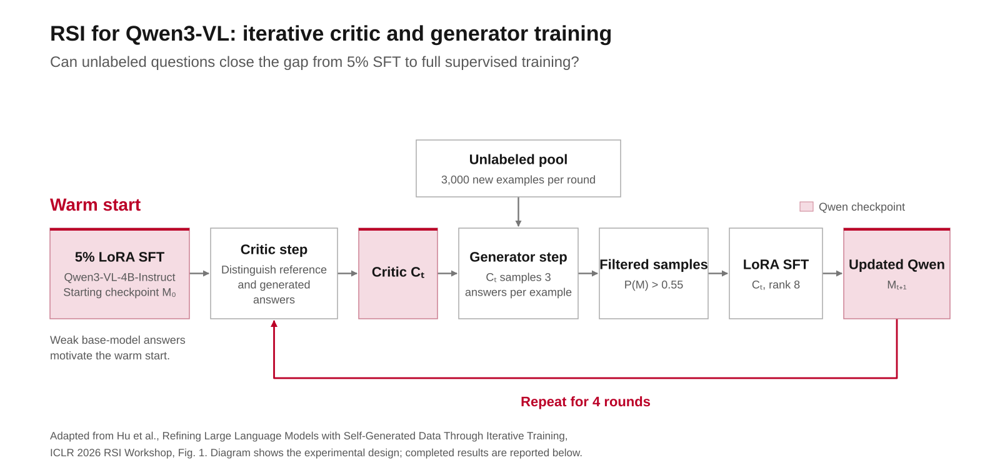

# SonoMed-VLM

**Building an ultrasound-domain vision-language model through model comparison, efficient adaptation, and evaluation of visual evidence use.**

[Study and results](docs/STUDY.md) · [Evaluation protocols](docs/OPEN_QA_V2.md) · [Scaling results](docs/RESEARCH.md) · [RSI and robustness](docs/RSI_AND_ROBUSTNESS.md)

## Research goal

Ultrasound has distinctive image appearance and acquisition variability. This study asks how to adapt a vision-language model (VLM) to ultrasound understanding: answering questions, describing findings and reports, and locating anatomy or lesions with bounding boxes. The goal is an ultrasound-domain VLM, with model selection as the first experimental step.

We explored three approximately size-matched models in sequence:

| Model | Why we examined it |
|---|---|
| **MedGemma 1.5 4B IT** | Our starting point: an established medical-imaging VLM and a natural candidate for ultrasound adaptation. |
| **Gemma 3 4B IT** | A general-purpose Gemma comparison, motivated by the hypothesis that specialization in other medical imaging modalities might make ultrasound adaptation harder. |
| **Qwen3-VL-4B-Instruct** | A strong contemporary general-purpose VLM to test whether broader multimodal capabilities provide a better starting point. |

The concern about MedGemma overfitting X-ray, MRI, or CT was a **research hypothesis**, not an established finding. These comparisons do not isolate medical specialization from architecture, processor, or pretraining differences. We use Qwen3-**VL**, the vision-language model; “state of the art” requires a named benchmark and date.

## Experiment progression

1. **Ultrasound adaptation:** clean and normalize SonoInstruct, construct image-group-safe splits, and apply LoRA supervised fine-tuning (SFT).
2. **Model comparison and data scaling:** compare Gemma, MedGemma, and Qwen at 5%; study MedGemma and Qwen across 1–100% of the corrected training pool.
3. **RSI / iterative self-training:** start from 5% Qwen SFT and test whether critic-filtered generated answers improve learning from additional unlabeled questions.
4. **Robustness and image reliance:** perturb, replace, or remove images to test how much predictions depend on visual input.

## Main observations

### Three-model comparison at 5% SFT

One epoch, rank-16 LoRA, seed 42; 9,251 training examples and 9,964 validation examples under the corrected `open_qa_v2` protocol.

| Model | Converted answer-text exact match | Ordinary QA / report token F1 | Grounding mean IoU |
|---|---:|---:|---:|
| Gemma 3 4B IT | 81.75% | 0.2972 | 0.2980 |
| MedGemma 1.5 4B IT | 84.65% | 0.3060 | 0.3257 |
| Qwen3-VL-4B-Instruct | 84.29% | 0.3119 | 0.5989 |

Converted questions are answered **without options**, using answer-text targets. Exact match here is not conventional MCQ accuracy. Task counts are 4,938 converted questions, 4,461 ordinary QA/report examples, and 565 boxes. These are single-seed internal results.

Qwen has the highest observed grounding score in this comparison. Gemma does not outperform MedGemma at 5%, so this experiment does not establish the initial hypothesis that a general Gemma model adapts more easily.



*From the presentation: gray = before, crimson = after 5% SFT. MedGemma/Qwen before and after answer-match scores use different protocols and must not be interpreted as controlled gains. The table above is the matched after-SFT comparison.*

### Data scaling

In the corrected full-data study, Qwen reaches **0.7496 mean IoU**, versus **0.5716** for MedGemma. Converted answer-text exact match is **91.13% / 91.29%**, respectively. Qwen at 5% reaches 0.5989 IoU, compared with full-data MedGemma's 0.5716. Larger fractions also receive more optimizer updates; this is not a matched-compute comparison.

[Full scaling tables, figures, and methods](docs/RESEARCH.md) · [Machine-readable results](results/research_results.json)



*The presentation graph shows the historical choices-omitted series, not the corrected results quoted above. Its MCQ panel reports semantic answer matching, not standard MCQ accuracy. See the [figure notes](docs/assets/interview/README.md) for protocol details.*

### RSI: a negative result



Four rounds of CoEvol-style self-training did **not** improve the 5% Qwen warm start. Open-response BERTScore F1 fell from **0.7694** to **0.7202** with critic filtering and **0.7350** with random selection. The critic arm was below the random arm at every round. This is evidence against this particular recipe, not against every self-improvement method.

### Robustness: images matter, and text contributes

On 1,000 sampled validation image groups, Qwen's weighted accuracy was **97.55%** with original images, **88.38%** with the strongest tested Gaussian noise, **43.11%** with gray images, and **57.07%** with text only. The original-to-high-noise drop was **9.17 percentage points**, paired 95% CI **[7.48, 10.89]**. This demonstrates image dependence under the tested conditions; it does not establish clinical robustness or eliminate shortcuts.

[RSI design, round-by-round results, robustness controls, and limitations](docs/RSI_AND_ROBUSTNESS.md)

## Data and protocol boundaries

SonoInstruct's 263,247 source records and project-normalized training examples are different counting units. The presentation's 187,526-example curated pool, the corrected scaling pool (187,761), and the historical pool (190,625) belong to different experiments. Do not interchange their denominators.

Historical runs omitted answer choices while retaining option-aware scoring. The corrected scaling study retrained with answer-text targets. The later choices-present image-reliance test and the 1,024-case RSI development evaluation are separate protocols. [Study guide](docs/STUDY.md) explains how to read them together without pooling their scores.

## Reproduce and explore

```bash
python -m pip install -e '.[viz]'
python scripts/plot_research_results.py
python scripts/plot_medical_transfer_results.py
```

These commands reproduce the published scaling and medical-transfer figures from aggregate results. See [training and evaluation instructions](docs/OPEN_QA_V2.md), [metric definitions](docs/EVALUATION.md), and [run registry](configs/openqa_v2_runs.json). The new RSI and robustness summaries report completed local experiments; their full runners and raw records are not included in this documentation update.

| Resource | Location |
|---|---|
| Study motivation, protocol map, provenance | [Study guide](docs/STUDY.md) |
| Corrected MedGemma/Qwen scaling | [Research report](docs/RESEARCH.md) |
| Controlled medical-QA intermediate-training experiment | [Medical transfer](docs/MEDICAL_INTERMEDIATE_TRANSFER.md) |
| RSI and image-reliance results | [Experiment summary](docs/RSI_AND_ROBUSTNESS.md) |
| September overview and detailed prior findings | [Historical overview](docs/SEPTEMBER_OVERVIEW.md) |
| Historical MedGemma adapter | [Model card](MODEL_CARD.md) · [Hugging Face](https://huggingface.co/jxia58/SonoMed-VLM-MedGemma-1.5-4B-LoRA) |

The released Hugging Face adapter contains historical v1 MedGemma weights, not the corrected retraining or the later Qwen checkpoints. Raw dataset content and private run outputs are not redistributed.

## Limitations and attribution

One-seed comparisons, internal validation, native processor differences, and lexical metrics limit conclusions. Image grouping does not guarantee patient independence. External validation and expert assessment remain needed; this is research software, not a clinically validated system.

Code: [Apache-2.0](LICENSE). Model and dataset terms apply separately; see [third-party notices](THIRD_PARTY_NOTICES.md) and [MedGemma terms](HAI_DEF_TERMS.md). SonoInstruct's authors already study ultrasound adaptation; this project contributes its comparative experiments and audits, not a first-ever ultrasound Qwen claim.
